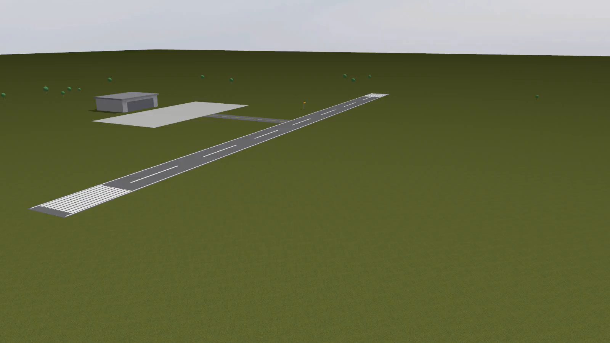
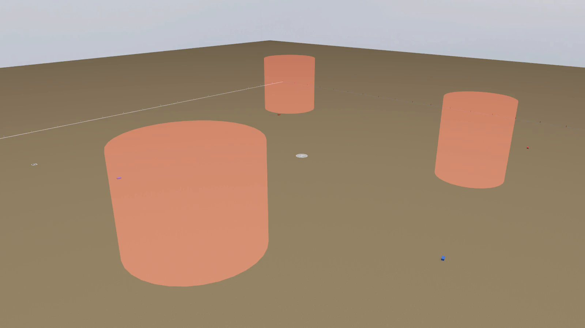
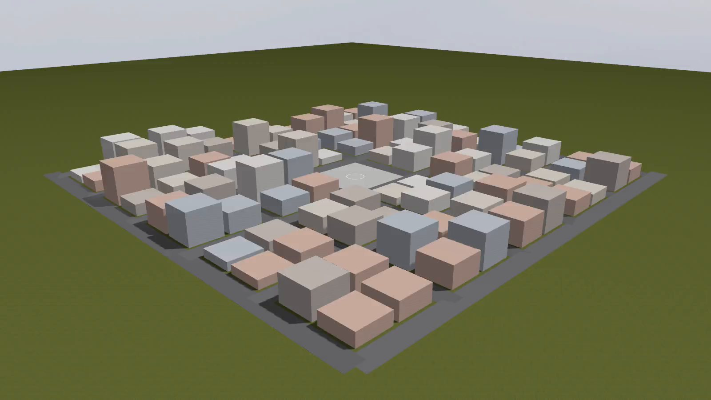

# hangar-worlds

**Ready-made Gazebo worlds for ArduPilot SITL**: an airfield, a mission arena
and a small town. They are built from code, light (about 1 MB in total), and
load the Gazebo systems ArduPilot needs.

| airfield | mission_arena | town |
|---|---|---|
|  |  |  |

[Türkçe](#türkçe)

## The worlds

**airfield**: a grass field with a **400 m × 20 m runway** running east-west,
with centre line, edge lines and thresholds. Around it are a taxiway, a
concrete apron, a hangar, a windsock and trees. Planes and VTOLs take off and
land here. Tested: a Skywalker X8 in ArduPlane's TAKEOFF mode leaves the
runway and climbs to 40 m. Start a plane at the west end, facing east:
`pose: [-170, 0, 0.3, 0, 0, 0]`.

**mission_arena**: a **1 km × 1 km** area with:
- the boundary painted on the ground, plus red and white posts every 50 m;
- a landing pad with an H at the centre;
- red and blue ground targets;
- a 7×7 marker board at (-320, 300);
- three **air-defence zones**: transparent red cylinders, 120 m high and 50 to
  80 m in radius, that are visual only and do not collide.

It suits competition-style missions: search, lock on a target, avoid zones.

**town**: 5 × 5 blocks with streets, buildings from 6 to 30 m high, and a
central square with a landing pad. It suits copters, low flight between
buildings and camera work.

All three sit at ArduPilot's default location (CMAC, -35.36, 149.17). A
scenario can set its own `home`.

## Use

### With Hangar

```bash
hangar sources fetch hangar_worlds
```

Then pick a world in the Scenario tab, or write `world: airfield` in a
scenario. Hangar downloads the release archive, shows the license and asks
first.

### On its own

```bash
git clone https://github.com/Enginar140/hangar-worlds
cd hangar-worlds/worlds/airfield
GZ_SIM_RESOURCE_PATH=$PWD gz sim airfield.sdf
```

## Change or add a world

The worlds are generated by [`tools/build.py`](tools/build.py), which uses
only the Python standard library. Each world is a function that places
boxes, cylinders and spheres, with fixed seeds, so the output is always the
same. Edit the function, run `python3 tools/build.py`, and commit the result.
CI checks that the committed worlds match the script.

## Licenses

- Worlds and code: MIT.
- Ground textures: [ambientCG](https://ambientcg.com) (Grass004, Ground054,
  Asphalt026B, Concrete034), [CC0](https://docs.ambientcg.com/license/).
  Free for any use, with no attribution needed. They are credited here anyway.

---

## Türkçe

**ArduPilot SITL için hazır Gazebo dünyaları**: havaalanı, görev alanı ve
küçük bir kasaba. Hepsi koddan üretiliyor ve toplam yaklaşık 1 MB tutuyor.

- **airfield (havaalanı)**: doğu-batı yönünde **400 m × 20 m pist** (orta
  çizgi, kenar çizgileri, eşikler), taksi yolu, apron, hangar, rüzgar tulumu.
  Test edildi: Skywalker X8, ArduPlane TAKEOFF moduyla pistten kalkıp 40 m'ye
  tırmanıyor. Uçağı pistin batı ucuna, doğuya bakacak şekilde koy:
  `pose: [-170, 0, 0.3, 0, 0, 0]`.
- **mission_arena (görev alanı)**: **1 km × 1 km**. İçinde zemine çizili
  sınır ve 50 m'de bir direkler, merkezde H'li iniş pedi, kırmızı ve mavi yer
  hedefleri, 7×7 işaret panosu ve üç **hava savunma bölgesi** var. Bölgeler
  yarı saydam kırmızı silindirler; sadece görseldir, çarpışma yoktur.
  Yarışma tipi görevler için uygun.
- **town (kasaba)**: 5 × 5 blok, 6-30 m yüksekliğinde binalar, ortada iniş
  pedli meydan. Copter ve kamera çalışmaları için uygun.

Hangar ile kurmak için: `hangar sources fetch hangar_worlds`, sonra Senaryo
sekmesinden dünyayı seç. Lisans: dünyalar ve kod MIT; dokular ambientCG'den,
CC0.
